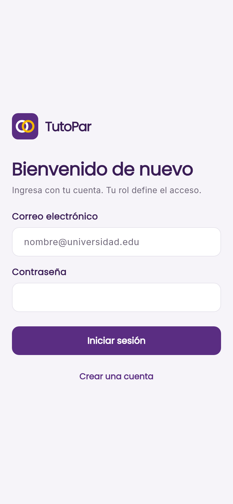
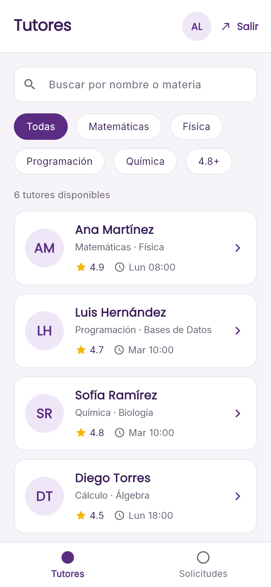
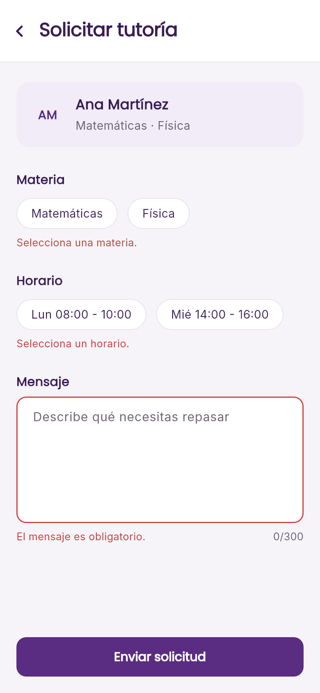

# App Tutorías

Aplicación móvil de tutorías académicas entre estudiantes. Un **alumno** encuentra tutores,
consulta su perfil y envía una solicitud; un **tutor** revisa las solicitudes recibidas y las
acepta o rechaza.

El proyecto aborda el **rezago académico** como problemática social, alineado con el
**ODS 4 (Educación de calidad)** de la Agenda 2030: facilitar el acceso a apoyo académico entre
pares dentro de la misma comunidad estudiantil.

> **Etapa 1 — MVP local.** Sin backend, sin Firebase y sin persistencia: los datos viven en
> memoria mientras la app está abierta. La arquitectura ya está preparada para conectar
> Firebase en la Etapa 2 mediante nuevas implementaciones del Repository.
> La conexión directa experimental con PostgreSQL se conserva aparte y no se utiliza al iniciar el MVP.

---

## Tabla de contenido

- [Alcance de la Etapa 1](#alcance-de-la-etapa-1)
- [Arquitectura](#arquitectura)
- [Estructura del proyecto](#estructura-del-proyecto)
- [Modelos y contratos](#modelos-y-contratos)
- [Pantallas](#pantallas)
- [Requisitos técnicos y cómo se cubren](#requisitos-técnicos-y-cómo-se-cubren)
- [Cómo ejecutar el proyecto](#cómo-ejecutar-el-proyecto)
- [Estado del proyecto](#estado-del-proyecto)
- [Etapa 2 (backlog)](#etapa-2-backlog)
- [Equipo y roles](#equipo-y-roles)
- [Convenciones de Git](#convenciones-de-git)
- [Decisiones abiertas](#decisiones-abiertas)
- [Uso de inteligencia artificial](#uso-de-inteligencia-artificial)

---

## Documento de definición y validación del equipo

[App Tutoría: documento externo del equipo](https://docs.google.com/document/d/1wgrwFpcxMS3E_8LmBLUwJRN8LDnaPhpGpQ6fEEzfg6w/edit?usp=sharing).

El documento incluye los requisitos MoSCoW, el público objetivo, cinco entrevistas,
transcripciones, gráficos y hallazgos. Las secciones 3.1, 3.3 y 15 todavía contienen pendientes
sobre cifras y fuentes. El apartado 9.2 debe distinguir al entrevistador del participante.
Estos pendientes corresponden al equipo; no se completaron con datos inventados.

La matriz siguiente resume prioridades ya declaradas en la sección 6 del documento del equipo:

| Prioridad | Alcance |
|---|---|
| Must | Entrada, catálogo, búsqueda, detalle con argumentos, solicitud validada y panel por rol. |
| Should | Filtros adicionales, estados de carga/vacío/error y cierre de sesión. |
| Could / Etapa 2 | Aprobación de tutores, notificaciones, intercambio y otras ampliaciones. |

## Alcance de la Etapa 1

| Dentro del MVP | Fuera del MVP (Etapa 2) |
|---|---|
| Tres roles: **Alumno**, **Tutor** y **Administrador** | Gestión administrativa de cuentas y perfiles |
| Siete pantallas con navegación por rutas nombradas | Notificaciones push |
| Datos de ejemplo en memoria (repositorios mock) | Firebase Auth y Firestore |
| Búsqueda y filtros en el catálogo de tutores | Chat o videollamada |
| Solicitudes con validaciones y cambio de estado | Persistencia entre sesiones |

**Flujo principal:** Bienvenida → Inicio de sesión o registro → Acceso según la cuenta → Catálogo → Detalle del tutor → Formulario de
solicitud → Panel de solicitudes.

- **Alumno:** explora tutores, filtra por materia/calificación/horario, envía solicitudes y
  consulta el estado de las suyas.
- **Tutor:** incluye al docente; consulta y responde únicamente sus solicitudes.
- **Administrador:** accede a un panel inicial propio con los datos de su sesión. La gestión de usuarios aún no está implementada.
- El registro público solo permite **Alumno** o **Tutor**. El administrador se crea por separado.

---

## Arquitectura

Los datos viajan en **una sola dirección** y cada capa tiene una única responsabilidad:

```
Pantalla  →  Provider  →  Repository (contrato)  →  Implementación
                                                     ├── Mock (Etapa 1)
                                                     └── Firebase Auth / Firestore (Etapa 2)
```

### Reglas

1. **Las pantallas no tienen lógica de negocio ni acceden a datos.** Solo dibujan lo que el
   Provider les entrega (`watch` al construir, `read` dentro de acciones como botones) y le
   informan lo que hizo el usuario.
2. **Los Providers no saben de dónde vienen los datos.** Reciben un `Repository` como clase
   abstracta; la implementación concreta les es indiferente.
3. **Un solo lugar decide qué implementación se usa: `main.dart`.** Ahí se registran los
   Providers con `MultiProvider` y se inyectan los repositorios mock. En la Etapa 2 solo cambia
   la selección de las implementaciones.

### Por qué esta arquitectura

- Cumple el mínimo técnico del curso (Provider, Model, Repository, rutas con argumentos).
- Permite que las tres personas trabajen en paralelo sobre contratos ya acordados.
- Permite sustituir los repositorios locales por implementaciones Firebase sin trasladar consultas a las pantallas.
- Facilita las pruebas: los repositorios mock son intercambiables y deterministas.

---

## Estructura del proyecto

La estructura separa componentes, pantallas, modelos, estado y acceso a datos. Los nombres de
archivos y variables se conservan en español y camelCase para facilitar su lectura.

```text
lib/
├── main.dart                   # Arranque del MVP local
├── core/
│   ├── routes/                 # Navegación y permisos por rol
│   ├── theme/                  # Tema, colores y tipografía
│   ├── utils/                  # Formato, avisos y constantes
│   └── widgets/                # Botones, campos, tarjetas y logotipo
├── features/
│   ├── auth/                   # Bienvenida, inicio de sesión y registro
│   ├── tutores/                # Catálogo y detalle del tutor
│   ├── solicitudes/            # Formulario y panel de solicitudes
│   └── admin/                  # Panel informativo adicional
├── models/                     # Usuario, Tutor, Solicitud y sus valores
├── providers/                  # Sesión, catálogo y solicitudes
└── repositories/
    ├── datosEjemplo.dart       # Listas locales del MVP
    ├── repositorioAutenticacion.dart
    ├── repositorioTutores.dart
    ├── repositorioSolicitudes.dart
    └── postgres/              # Experimento opcional, fuera del arranque local
```

El contrato y su implementación simulada comparten archivo. Los Providers reciben los
repositorios por constructor. `main.dart` selecciona `MockAuthRepository`,
`MockTutoresRepository` y `MockSolicitudesRepository`; no se necesitan variables de entorno,
PostgreSQL ni conexión a internet para probar los flujos después de instalar la aplicación.

---

## Modelos y contratos

### Modelos

Todos incluyen `toMap()` y `fromMap()` desde la Etapa 1, y todos los identificadores son
`String`, para intercambiarlos con la futura implementación de Firebase.

| Modelo | Campos |
|---|---|
| `Usuario` | `id`, `nombre`, `correo`, `rol` (`alumno` \| `tutor` \| `administrador`) |
| `Tutor` | `id`, `nombre`, `materias`, `calificacion`, `horariosDisponibles`, `descripcion`, `foto` |
| `Solicitud` | `id`, `idAlumno`, `idTutor`, `materia`, `horario`, `mensaje`, `estado` (`pendiente` \| `aceptada` \| `rechazada`), `fecha` |

> El usuario con rol `tutor` comparte `id` con su entrada en el catálogo de tutores, de modo que
> `listarPorTutor` y el panel del tutor funcionan sin tablas intermedias.

### Repositorios (contratos abstractos)

Métodos **asíncronos** desde el inicio, aunque los datos sean locales. Así la firma no cambia
cuando se conecte Firebase.

| Contrato | Métodos |
|---|---|
| `AuthRepository` | `iniciarSesion(correo, contrasena)`, `registrar(nombre, correo, contrasena, rol)`, `cerrarSesion()` |
| `TutoresRepository` | `obtenerTutores()`, `obtenerTutorPorId(id)` |
| `SolicitudesRepository` | `crear(solicitud)`, `listarPorAlumno(idAlumno)`, `listarPorTutor(idTutor)`, `cambiarEstado(id, estado)` |

El acceso comprueba correo y contraseña contra cuentas en memoria. El rol procede de la cuenta
validada. El registro permite crear alumnos y tutores; se inicia sesión al completar el registro.
Los datos del usuario nunca incluyen la contraseña en `toMap()`.

### Providers

| Provider | Responsabilidad |
|---|---|
| `SesionProvider` | Usuario actual y rol; registro, inicio y cierre de sesión |
| `TutoresProvider` | Lista de tutores, texto de búsqueda, filtros, resultados filtrados, estados de carga y error |
| `SolicitudesProvider` | Solicitudes según el rol, creación, aceptación y rechazo |

### Rutas

Un único archivo con los nombres como constantes y navegación con **rutas nombradas**. El detalle
del tutor recibe el **`id` como argumento**, no el objeto completo, y lo resuelve a través del
Provider.

---

## Pantallas

| # | Pantalla | Rol | Descripción |
|---|---|---|---|
| 1 | Bienvenida | Todos | Muestra la marca y abre el inicio de sesión. |
| 2 | Inicio de sesión y registro | Todos | Valida credenciales; al registrarse solo se puede elegir alumno o tutor. |
| 3 | Catálogo de tutores | Alumno | Lista tutores con búsqueda y filtros. |
| 4 | Detalle del tutor | Alumno | Muestra el perfil y abre el formulario. |
| 5 | Nueva solicitud | Alumno | Valida materia, horario y mensaje. |
| 6 | Solicitudes | Alumno y Tutor | Cada usuario consulta sus solicitudes; el tutor responde las que recibió. |
| 7 | Administración | Administrador | Panel inicial con información de la sesión, sin gestión de usuarios todavía. |

---

## Requisitos técnicos y cómo se cubren

Las siete pantallas están implementadas y funcionan con datos de ejemplo en memoria.

| Requisito | Cómo se cumple |
|---|---|
| Entrada y mínimo 4 pantallas | Bienvenida, acceso/registro, catálogo, detalle, formulario, solicitudes y administración (7) |
| Listado con búsqueda o filtros | Catálogo con `TutoresProvider` |
| Detalle que recibe argumentos | Detalle del tutor con el `id` como argumento |
| Estado compartido con Provider | `SesionProvider`, `TutoresProvider` y `SolicitudesProvider` |
| Tema global y 2 componentes reutilizables | `temaAplicacion.dart` y componentes en `lib/` |
| Assets propios en `pubspec.yaml` | `assets/images/logoTutopar.png`, usado en la bienvenida; fuentes locales Poppins e Inter |
| Model y Repository | Modelos y archivos `repositorio*.dart` en `lib/` |
| Validaciones en formularios | Formulario de solicitud (campos obligatorios, longitud del mensaje, horario elegido) |

---

## Capturas de la aplicación actual

Capturas renderizadas desde los widgets reales del MVP, con viewport de 390 × 844.
Los bocetos anteriores se conservan en `docs/Diseño/`.

<p>
  
  
  
</p>

Las demás capturas están en [docs/capturas](docs/capturas/).

## Cuentas locales de prueba

Todas usan la contraseña de demostración **`Tutorias123!`**.

| Correo | Rol | Pantalla inicial |
|---|---|---|
| `ana.alumno@tutopar.local` | Alumno | Catálogo de tutores |
| `pedro.alumno@tutopar.local` | Alumno | Catálogo y solicitudes de Pedro |
| `ana.tutor@tutopar.local` | Tutor | Solicitudes recibidas |
| `admin@tutopar.local` | Administrador | Panel de administración |

Las cuentas nuevas se conservan al cerrar sesión, pero se pierden al cerrar o reiniciar la
aplicación. La versión de entrega utiliza datos ficticios en memoria. La implementación
PostgreSQL del repositorio es un experimento de escritorio separado y no se ejecuta en el MVP.

## Cómo ejecutar el proyecto

### Requisitos

- Una instalación de Flutter compatible con el requisito de Dart `sdk: ^3.12.1` declarado en `pubspec.yaml`.
- Android SDK para generar el APK.
- En Windows se puede compilar `android`, `web` y `windows`; `ios`, `macos` y `linux` no son
  compilables en este entorno.

### Comandos

```powershell
# Instalar dependencias (obligatorio antes de analizar, testear o ejecutar)
flutter pub get

# Análisis estático y pruebas
flutter analyze
flutter test

# Ejecutar en escritorio o en el navegador
flutter run -d windows
flutter run -d edge

# Generar el APK de demostración
flutter build apk --debug
```

> Las dependencias se descargan al preparar el proyecto. El APK local no necesita red ni una base de datos externa.
> La firma del APK debug es de desarrollo; no corresponde a una publicación en una tienda.

---

## Estado del proyecto

**Actualizado:** 5 de noviembre de 2026.

La aplicación cuenta con siete pantallas funcionales, estado compartido con Provider,
rutas con control de acceso por rol y repositorios con datos en memoria. `lib/` se organiza en
`core`, `features`, `models`, `providers` y `repositories`, con nombres en español y camelCase.

Los contratos y sus implementaciones simuladas comparten archivo. Cada modelo agrupa sus
valores relacionados (rol o estado). Los colores están en el tema, el cierre de sesión en
su botón y la etiqueta de estado junto a la tarjeta de solicitud.

Cada línea de código de `lib/` lleva un comentario en español para facilitar su lectura.
El formulario utiliza una sola función para validar el mensaje al escribir y al enviar.

| Elemento | Estado |
|---|---|
| Separación por carpetas y nombres camelCase | Implementado. |
| Modelos, contratos y repositorios simulados | Implementado. |
| Providers y rutas con argumentos | Implementado. |
| Tema y componentes reutilizables | Implementado. |
| Siete pantallas y validación de solicitudes | Implementado. |
| Pruebas automatizadas | 21 aprobadas: credenciales, registro, permisos, filtros, arranque real local y flujos visuales. |
| Análisis del código | Sin errores ni advertencias en `lib` y `test` (5 de noviembre de 2026). |
| APK de entrega | Compilado en `build/app/outputs/flutter-apk/app-debug.apk`; la instalación y demo en dispositivo deben confirmarse. |
| Autenticación real y persistencia | Pendientes para la Etapa 2. |


---

## Etapa 2 (backlog)

La Etapa 2 de la rúbrica utiliza **Firebase Auth y Firestore**. Los contratos de los repositorios
permiten agregar las implementaciones remotas y seleccionarlas en `main.dart`.

| Prioridad | Trabajo pendiente | Criterio de aceptación propuesto |
|---|---|---|
| Must | Implementación de `AuthRepository` con Firebase Auth | Registro, inicio y cierre de sesión sin contraseñas almacenadas por Flutter. |
| Must | Tutores y solicitudes en Firestore | Los datos se conservan entre dispositivos y se consultan por usuario. |
| Must | Reglas de acceso del servidor | Cada alumno consulta lo suyo y cada tutor responde sus propias solicitudes. |
| Should | Perfiles de tutores y aprobación administrativa | Un tutor puede proponer su perfil y el administrador aprobarlo. |
| Should | Notificación de cambios de solicitud | El alumno conoce si se aceptó o rechazó su solicitud. |
| Could | Intercambio de asesorías y reconocimiento | El equipo delimita esta función a partir de las entrevistas, sin simular que ya existe. |
| Could | Chat, videollamada y reportes | Requieren definición adicional y quedan fuera del MVP local. |

El experimento de conexión directa a PostgreSQL está en
`lib/repositories/postgres/repositorioAutenticacionPostgres.dart`. Se conserva como trabajo
adicional de escritorio; no se exige ni se activa para la entrega local.

---

## Equipo y roles

Los roles pueden rotar. Regla de la rúbrica: **los tres programan** y cada uno es responsable
principal de una función completa (pantalla, lógica y datos).

| Rol | Responsabilidad principal | Función de código |
|---|---|---|
| **Rol 1 — Diseño UI/UX (Erick)** | Wireframes, sistema de diseño, tema global, 2 componentes reutilizables, consistencia visual en los PR | Entrada y sesión: bienvenida, registro, inicio de sesión, `SesionProvider` y `AuthRepository` mock |
| **Rol 2 — Arquitectura y Git (Elihu)** | Estructura, contratos, rutas, `MultiProvider`, revisión de PR, APK, README técnico | Solicitudes: formulario con validaciones y panel por rol |
| **Rol 3 — Coordinación y documentación (Heidi)** | Documento de definición, validación con usuarios, README, `AI_LOG.md`, guion de demo | Tutores: catálogo con búsqueda/filtros y detalle con argumentos |

**Orden de dependencias:** Rol 2 publica modelos y contratos antes de que los demás empiecen sus
pantallas. Rol 1 entrega tema y componentes antes de que se construyan las pantallas.

---

## Convenciones de Git

- `main` **siempre compila**. Nadie hace push directo a `main`.
- Una rama por función: `feature/entrada`, `feature/tutores`, `feature/solicitudes`, más una
  para la configuración inicial.
- Cada pull request debe ser revisado por al menos otra persona antes de unirse a `main`.
- Mensajes de commit descriptivos: qué se hizo y por qué.
- Hacer `pull` antes de empezar a trabajar.
- Avisar antes de tocar archivos compartidos: `pubspec.yaml`, `main.dart` y `rutasAplicacion.dart`.
- Antes de abrir un PR: `flutter analyze` sin issues y `flutter test` en verde.

---

## Decisiones y coherencia documental

| Tema | Estado comprobable en el código |
|---|---|
| Nombre visible de esta compilación | TutoPar. El documento del equipo dice MetroTutor; el equipo debe unificar la decisión. |
| Navegación | Rutas nombradas de Flutter con argumentos. El documento menciona `go_router`; la rúbrica no obliga a ese paquete. |
| Datos locales | Listas Dart en `lib/repositories/datosEjemplo.dart`. El documento menciona JSON; el equipo debe reflejar la opción realmente utilizada. |
| Administración | Panel informativo adicional; no existe aprobación ni gestión de usuarios. |
| Filtros | Materia, calificación y día en el controlador; búsqueda por nombre o materia. |
| Persistencia remota | Fuera del MVP; Firebase corresponde al backlog de la Etapa 2. |

---

## Uso de inteligencia artificial

La bitácora [AI_LOG.md](AI_LOG.md) registra de forma retrospectiva la ayuda observable en esta
conversación, incluida la generación de código completo y de partes del README. Esos usos
superan los límites de la sección 7 de la rúbrica y deben revisarse con el docente. El registro
no convierte automáticamente esos usos en permitidos ni acredita la defensa individual.

La revisión técnica de archivos, rutas y verificaciones del 5 de noviembre de 2026 también
se realizó con asistencia de IA. El equipo debe revisar la documentación final y explicar su
código. No se generaron ni se alteraron entrevistas o resultados de investigación en este ajuste.

Fuentes técnicas consultadas durante el trabajo:

- [Flutter: documentación](https://docs.flutter.dev/).
- [Provider: documentación del paquete](https://pub.dev/packages/provider).
- [Postgres para Dart: documentación del experimento opcional](https://pub.dev/packages/postgres).
- [BCrypt para Dart: documentación del experimento opcional](https://pub.dev/packages/bcrypt).

---

## Licencia

Proyecto académico de la clase de Móviles-UPMH. Sin licencia definida por ahora.
